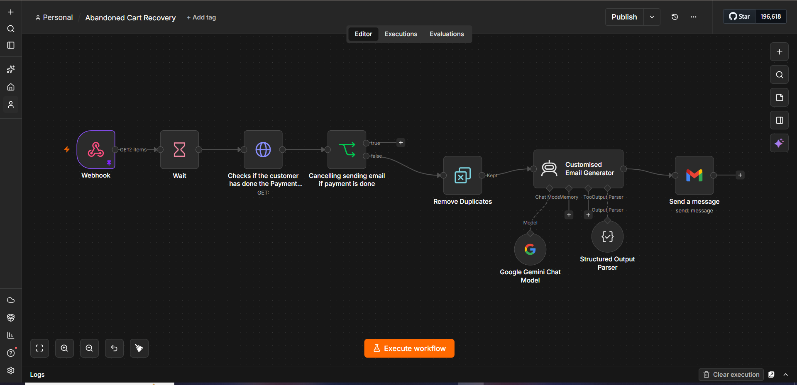

# Abandoned Cart Recovery

Recovers abandoned carts by waiting 24 hours and, if the customer still has not paid, generating and sending a personalized recovery email.

## What it does

Listens for cart events via webhook, removes duplicate events, waits 24 hours, checks whether the customer completed payment during the wait, and - if not - uses Google Gemini to draft a personalized recovery email and sends it through Gmail.

## How it works

1. Webhook - receives the cart event (POST).
2. Remove Duplicates - deduplicates events by id.
3. Wait - pauses the workflow for 24 hours.
4. HTTP Request - checks whether the customer completed payment during the wait period.
5. If - Cancelling sending email if payment is done - branches on payment status.
6. Customised Email Generator - LangChain agent powered by Google Gemini 2.5 Flash with a Structured Output Parser that returns subject, body, and image.
7. Send a message (Gmail) - sends the recovery email to the configured address.

## Nodes & services

Webhook, Remove Duplicates, Wait, HTTP Request, IF, LangChain Agent (Google Gemini 2.5 Flash), Structured Output Parser, Gmail.

## Files

- Abandoned Cart Recovery.json - n8n workflow export
- Abandoned Cart Recovery.PNG - canvas screenshot

## Setup

1. Import Abandoned Cart Recovery.json into n8n (Workflows Import).
2. Configure credentials for Gmail and the HTTP request endpoint.
3. Set the webhook path and replace placeholder URLs.
4. Save and activate the workflow.

## Credentials required

- Gmail
- HTTP Request (basic/auth header depending on your checkout platform)

