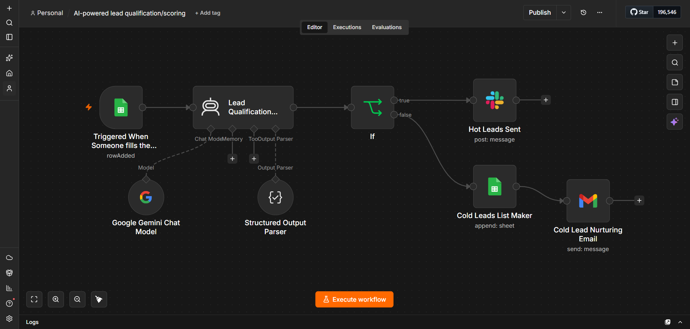

# AI-powered Lead Qualification + Scoring

Qualifies Typeform leads submitted through Google Sheets: hot leads are routed to Slack, cold leads receive a nurture email, and everything is logged back to Sheets.

## What it does

When a new row is added to the tracking sheet, a Gemini agent scores the lead as hot or cold with a reason. Hot leads get a Slack alert. Cold leads get a polite nurture email (Thanks for reaching out to Big Foot) and are appended to a cold-leads list.

## How it works

1. Google Sheets Trigger - triggers when a row is added (Typeform submissions).
2. Lead Qualification Centre - LangChain agent (Google Gemini 2.5 Flash plus Structured Output Parser) that classifies the lead (lead, reason).
3. If - branches on hot versus cold.
4. Hot Leads Sent - posts full lead details to a Slack channel.
5. Cold Lead Nurturing Email - sends a nurture email via Gmail to the lead's work email.
6. Cold Leads List Maker - appends the row to the cold leads sheet.

## Nodes & services

Google Sheets Trigger, LangChain Agent (Gemini 2.5 Flash), Structured Output Parser, IF, Slack, Gmail, Google Sheets (append).

## Files

- AI-powered lead qualification_scoring.json - n8n workflow export
- AI-powered lead qualification_scoring.PNG - canvas screenshot

## Setup

1. Import the JSON into n8n.
2. Configure Gemini, Google Sheets, Slack, and Gmail credentials.
3. Set the spreadsheet IDs, sheet names, and the trigger range.
4. Save and activate.

## Credentials required

- Google Gemini API
- Google Sheets
- Slack
- Gmail

