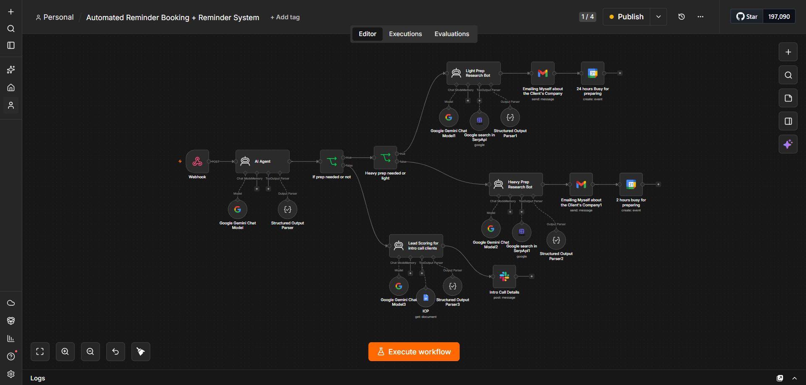

# Automated Reminder Booking + Reminder System

Books intro calls, researches the client, scores fit against your ICP, blocks prep time on the calendar, and notifies you by Slack and Gmail.

## What it does

When a new booking arrives via webhook, a Gemini agent extracts the call type and event details, runs Google searches, prepares heavy or light client research, scores the lead against your ICP document, blocks 2-hour and 24-hour prep time on Google Calendar, and sends you a summary by email and Slack.

## How it works

1. Webhook - receives the booking payload (POST).
2. AI Agent - Gemini agent extracts call type and event title from the payload.
3. Google Search (SerpApi) - researches the client company.
4. Heavy Prep Research Bot / Light Prep Research Bot - Gemini agents prepare call notes based on intensity.
5. If prep needed or not - branches on whether research is required.
6. Lead Scoring for intro call clients - scores the lead against the ICP Google Doc.
7. Intro Call Details - posts the screening result to Slack.
8. 24 hours Busy for preparing / 2 hours busy for preparing - blocks time on Google Calendar.
9. Emailing Myself about the Client's Company - sends a Gmail summary.

## Nodes & services

Webhook, LangChain Agent (Gemini 2.5 Flash), Structured Output Parser, SerpApi (Google search), Google Docs tool, IF, Slack, Google Calendar, Gmail.

## Files

- Automated Reminder Booking + Reminder System.json - n8n workflow export
- Automated Reminder Booking + Reminder System.PNG - canvas screenshot

## Setup

1. Import the JSON into n8n.
2. Configure Gemini, SerpApi, Google Docs, Slack, Google Calendar, and Gmail credentials.
3. Set the webhook path, ICP document URL, calendar, and Slack channel.
4. Save and activate.

## Credentials required

- Google Gemini API
- SerpApi
- Google Docs
- Slack
- Google Calendar
- Gmail

