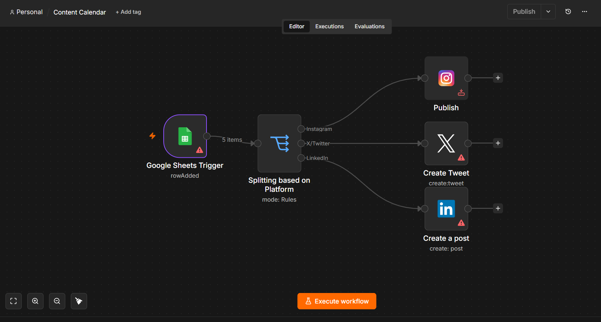

# Content Calendar

Publishes content across Twitter, Instagram, and LinkedIn from a Google Sheets content calendar.

## What it does

When a new row is added to the content calendar sheet, a Switch node routes the post by platform and publishes it as a tweet, Instagram post, or LinkedIn post.

## How it works

1. Google Sheets Trigger - triggers when a row is added.
2. Splitting based on Platform - Switch node routes by platform.
3. Create Tweet (Twitter) - publishes to Twitter.
4. Publish (Instagram) - publishes to Instagram.
5. Create a post (LinkedIn) - publishes to LinkedIn.

## Nodes & services

Google Sheets Trigger, Switch, Twitter, Instagram, LinkedIn.

## Files

- Content Calendar.json - n8n workflow export
- Content Calendar.PNG - canvas screenshot

## Setup

1. Import the JSON into n8n.
2. Configure Twitter, Instagram, and LinkedIn credentials (n8n community nodes).
3. Set the spreadsheet ID and sheet name.
4. Save and activate.

## Credentials required

- Twitter
- Instagram
- LinkedIn
- Google Sheets

