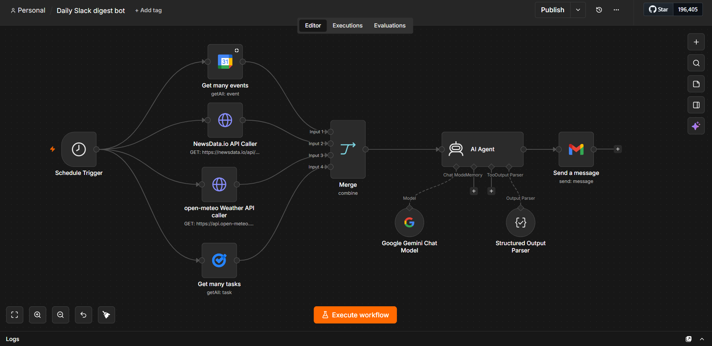

# Daily Email Digest Bot

Sends a daily digest email combining calendar events, tasks, weather, and news.

## What it does

Runs on a schedule, fetches today's Google Calendar events and Google Tasks, pulls weather from open-meteo (Rewari, Haryana coordinates: 28.392109, 76.450122) and latest news from NewsData.io, merges everything, and uses a Gemini agent to write and send a digest email via Gmail.

## How it works

1. Schedule Trigger - runs daily.
2. Get many events - Google Calendar events for today.
3. Get many tasks - Google Tasks.
4. open-meteo Weather API caller - HTTP request to open-meteo forecast.
5. NewsData.io API Caller - HTTP request to NewsData.io latest news.
6. Merge - combines calendar, tasks, weather, and news.
7. AI Agent - Gemini writes the digest email (subject plus body).
8. Send a message (Gmail) - sends the digest to the configured address.

## Nodes & services

Schedule Trigger, Google Calendar, Google Tasks, HTTP Request (open-meteo, NewsData.io), Merge, LangChain Agent (Gemini 2.5 Flash), Structured Output Parser, Gmail.

## Files

- Daily Email digest bot.json - n8n workflow export
- Daily Email Digest Bot.PNG - canvas screenshot

## Setup

1. Import the JSON into n8n.
2. Configure Gemini, Google Calendar, Google Tasks, and Gmail credentials.
3. Add API keys for NewsData.io in the HTTP request node.
4. Save and activate.

## Credentials required

- Google Gemini API
- Google Calendar
- Google Tasks
- Gmail
- NewsData.io API key

