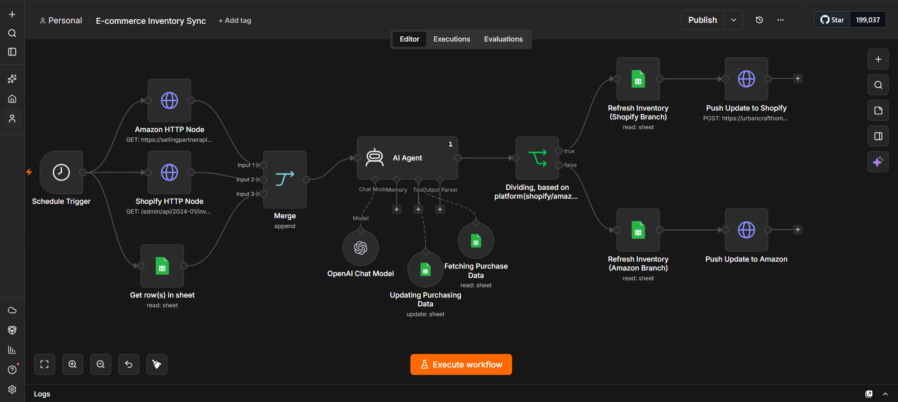

# E-commerce Inventory Sync

Scheduled inventory synchronization between Shopify and Amazon, with changes logged and pushed back to both platforms via Google Sheets.

## What it does

Runs on a schedule, pulls inventory from Amazon Selling Partner API and Shopify, merges the data, summarizes with an AI agent, compares against the Google Sheets master list, and pushes stock updates back to Shopify or Amazon depending on the source.

## How it works

1. Schedule Trigger - runs on a schedule.
2. Amazon HTTP Node - fetches catalog items from the Selling Partner API.
3. Shopify HTTP Node - fetches inventory levels from Shopify.
4. Merge - combines the three data inputs.
5. AI Agent - OpenAI agent summarizes the sync cycle.
6. Google Sheets tools - fetch and update purchase and quantity data in Sheets.
7. If - Dividing based on platform - branches Shopify versus Amazon.
8. Refresh Inventory (Shopify/Amazon Branch) - updates Google Sheets.
9. Push Update to Shopify / Push Update to Amazon - HTTP POST/PATCH inventory updates.

## Nodes & services

Schedule Trigger, HTTP Request (Amazon SP-API, Shopify), Merge, LangChain Agent (OpenAI), Google Sheets tool, IF, Google Sheets.

## Files

- E-commerce Inventory Sync.json - n8n workflow export
- E-commerce inventory sync.PNG - canvas screenshot

## Setup

1. Import the JSON into n8n.
2. Configure OpenAI, Google Sheets, and HTTP authentication for Amazon SP-API and Shopify.
3. Set the spreadsheet ID, Shopify location ID, and API endpoints.
4. Save and activate.

## Credentials required

- OpenAI API
- Google Sheets
- HTTP Request (Amazon SP-API, Shopify)

