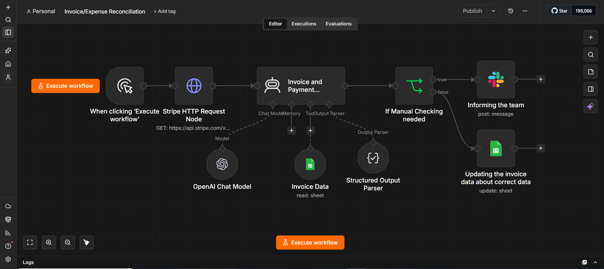

# Invoice + Expenses Reconciliation

Reconciles Stripe charges against invoice data in Google Sheets and flags items needing manual review.

## What it does

Started manually, the workflow pulls Stripe charges, reads invoice data from Google Sheets, uses an OpenAI agent to match payments to invoices, and - when manual checking is needed - alerts the team on Slack and updates the sheet with corrected data.

## How it works

1. Manual Trigger - starts the reconciliation run.
2. Stripe HTTP Request Node - fetches charges from the Stripe API.
3. Invoice Data - Google Sheets tool reading the invoice data.
4. Invoice and Payment Checker - OpenAI agent with structured output (name, status, reason).
5. If Manual Checking needed - branches on match confidence.
6. Informing the team - posts payment and invoice details to Slack.
7. Updating the invoice data - writes corrected data back to Google Sheets.

## Nodes & services

Manual Trigger, HTTP Request (Stripe), Google Sheets tool, LangChain Agent (OpenAI), Structured Output Parser, IF, Slack, Google Sheets.

## Files

- Invoice+Expense Reconciliation.json - n8n workflow export
- Invoice+Expenses Reconciliation.PNG - canvas screenshot

## Setup

1. Import the JSON into n8n.
2. Configure Stripe, OpenAI, Google Sheets, and Slack credentials.
3. Set the spreadsheet ID and Stripe API key.
4. Save and activate (run manually as needed).

## Credentials required

- Stripe API
- OpenAI API
- Google Sheets
- Slack

