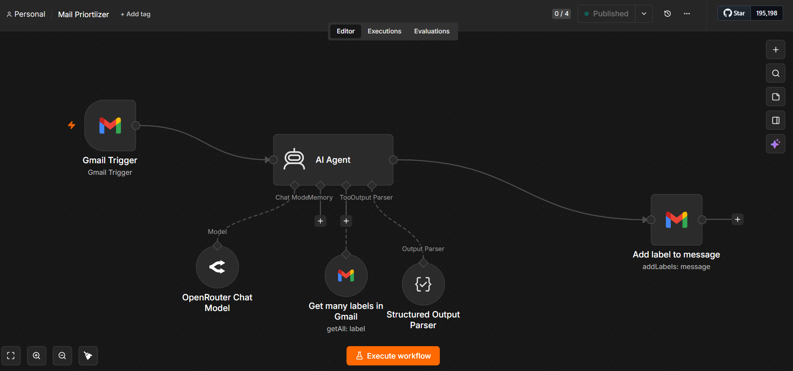

# Mail Prioritiser

Automatically prioritizes incoming Gmail messages and applies the right labels.

## What it does

Polls Gmail for new mail (max 5 per run), uses a Groq agent to determine the priority label, parses the result, and applies the label to the message in Gmail.

## How it works

1. Gmail Trigger - polls for new emails (maxResults 5).
2. AI Agent - Groq (llama-3.3-70b-versatile) agent prioritizes the mail.
3. Structured Output Parser - parses labelid.
4. Add label to message - applies the label in Gmail.

## Nodes & services

Gmail Trigger, LangChain Agent (Groq llama-3.3-70b-versatile), Structured Output Parser, Gmail (add labels).

## Files

- Mail Priortizer.json - n8n workflow export
- Mail_Prioritiser.PNG - canvas screenshot

## Setup

1. Import the JSON into n8n.
2. Configure Groq and Gmail credentials.
3. Set the Gmail label IDs and poll interval.
4. Save and activate.

## Credentials required

- Groq API
- Gmail

