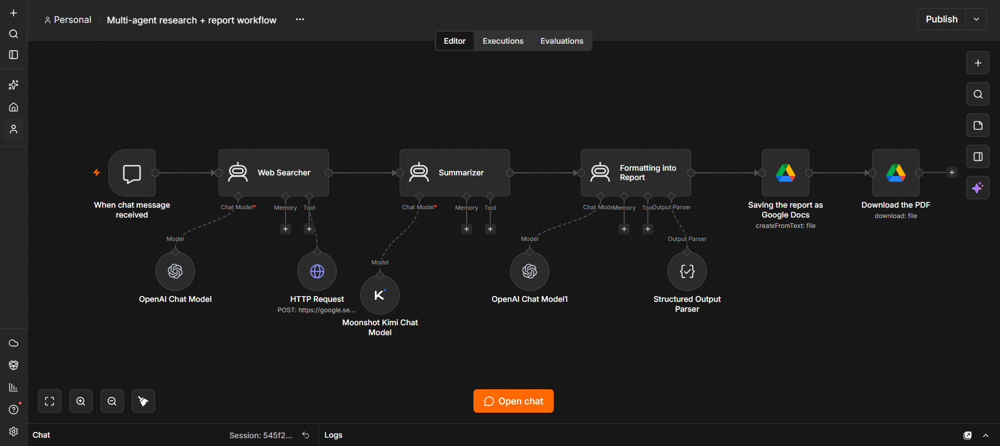

# Multi-agent Research + Report Workflow

Researches a company using web search and multiple LLM agents, then generates a formatted report saved to Google Docs and downloaded as PDF.

## What it does

Triggered by a chat message, the workflow searches the web via Serper, summarizes findings with a Moonshot Kimi model, formats a structured report with OpenAI, saves it as a Google Doc, and downloads the PDF.

## How it works

1. When chat message received - chat trigger (LangChain).
2. Web Searcher - agent that searches Google via Serper (HTTP request tool).
3. Summarizer - summarizes search output.
4. Moonshot Kimi Chat Model - reasoning model for the research step.
5. Formatting into Report - OpenAI agent producing structured report and name.
6. Saving the report as Google Docs - creates a Google Doc from the report text.
7. Download the PDF - downloads the created file from Google Drive.

## Nodes & services

Chat Trigger, HTTP Request tool (Serper), LangChain Agent (OpenAI), Moonshot Kimi, OpenAI Chat Model, Structured Output Parser, Google Drive.

## Files

- Multi-agent research + report workflow.json - n8n workflow export
- Multi-agent research + report workflow.PNG - canvas screenshot

## Setup

1. Import the JSON into n8n.
2. Configure OpenAI, Moonshot Kimi, Serper (via HTTP request), and Google Drive credentials.
3. Set the target Drive folder ID.
4. Save and activate.

## Credentials required

- OpenAI API
- Moonshot (Kimi) API
- Serper API key
- Google Drive

