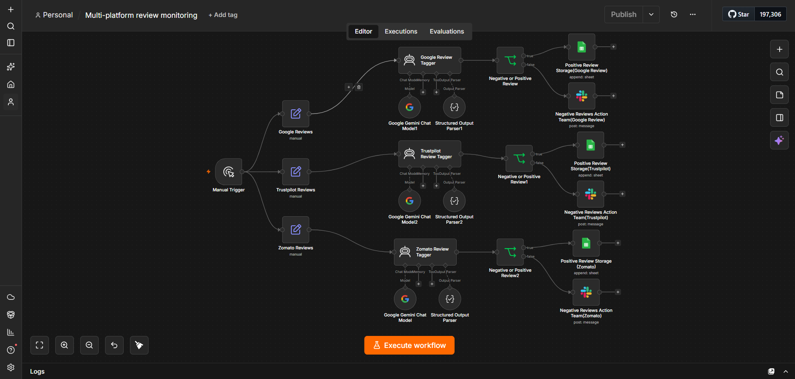

# Multi-platform Review Monitor

Monitors Google Reviews, Trustpilot, and Zomato reviews, tags each review with Gemini, stores positive reviews in Sheets, and alerts the team on Slack for negative ones.

## What it does

Triggered manually, the workflow pulls reviews from three platforms, runs a per-platform Gemini tagger (tag, starred/texted flag, review text), then routes positive reviews to platform-specific Google Sheets and negative reviews to platform-specific Slack alerts.

## How it works

1. Manual Trigger - starts the monitoring run.
2. Google Reviews / Trustpilot Reviews / Zomato Reviews - Set nodes holding the review data.
3. Per-platform Review Tagger - Gemini agents tag each review (tag, texted_or_starred, review).
4. Negative or Positive Review - IF nodes split by sentiment.
5. Positive Review Storage - appends to Google Sheets (one sheet per platform).
6. Negative Reviews Action Team - posts to Slack (one alert per platform).

## Nodes & services

Manual Trigger, Set, LangChain Agent (Gemini 2.5 Flash), Structured Output Parser, IF, Google Sheets, Slack.

## Files

- Multi-platform review monitoring.json - n8n workflow export
- Multi-platform review monitor.PNG - canvas screenshot

## Setup

1. Import the JSON into n8n.
2. Configure Gemini, Google Sheets, and Slack credentials.
3. Set spreadsheet IDs, sheet names, and Slack channel IDs.
4. Save and activate (run manually or on a schedule).

## Credentials required

- Google Gemini API
- Google Sheets
- Slack

