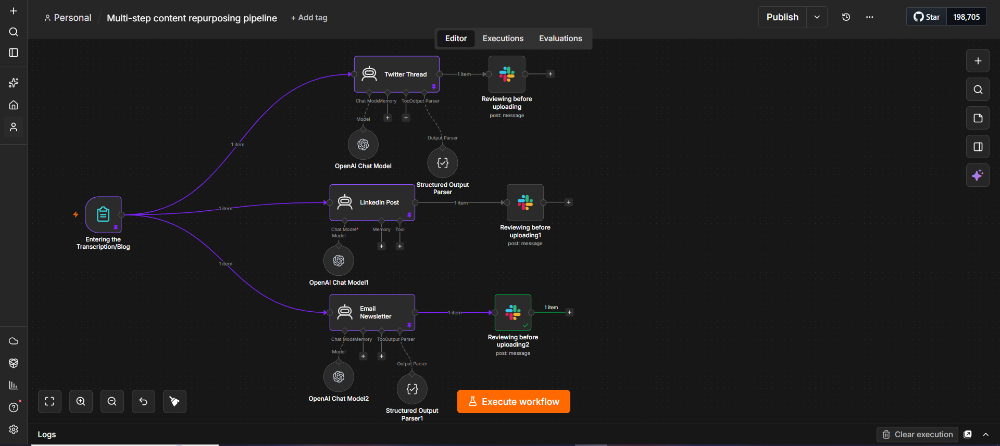

# Multi-step Content Repurposing Pipeline

Turns a single transcript or blog post into a LinkedIn post, a Twitter thread, and an email newsletter, with human review on Slack before anything is published.

## What it does

A form (Multi-media Posting Agent) collects the transcript or blog, then three OpenAI agents generate the LinkedIn post, Twitter thread, and email newsletter (subject plus body). Each output is sent to Slack for review-and-approval (sendAndWait) before publishing.

## How it works

1. Entering the Transcription/Blog - FormTrigger with the source text.
2. LinkedIn Post - OpenAI agent generates the LinkedIn post.
3. Twitter Thread - OpenAI agent generates the thread.
4. Email Newsletter - OpenAI agent generates subject and body.
5. Reviewing before uploading x3 - Slack sendAndWait approval for each asset.

## Nodes & services

FormTrigger, LangChain Agent (OpenAI) x3, Structured Output Parser, Slack.

## Files

- Multi-step content repurposing pipeline.json - n8n workflow export
- Multi-step content repurposing pipeline.PNG - canvas screenshot

## Setup

1. Import the JSON into n8n.
2. Configure OpenAI and Slack credentials.
3. Set the Slack channel ID and form fields.
4. Save and activate.

## Credentials required

- OpenAI API
- Slack

