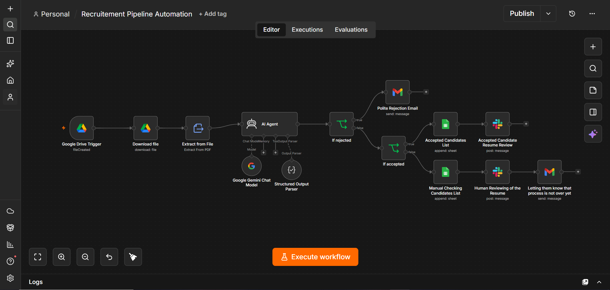

# Recruitment Pipeline Automation

Screens resumes dropped into a Google Drive folder: accepted candidates are listed and announced, rejected ones get a polite email, and borderline ones go to manual review.

## What it does

When a resume file is created in the watched Drive folder, it is downloaded, the PDF text is extracted, and a Gemini agent scores it (score, status, reason, email, applicant name). Rejected applicants get a polite rejection email, accepted ones go to an accepted list plus Slack notification, and the rest go to a manual review list with an application in progress email and Slack review.

## How it works

1. Google Drive Trigger - triggers when a file is created in the folder.
2. Download file - downloads the resume from Drive.
3. Extract from File - extracts text from the PDF.
4. AI Agent - Gemini agent scores the resume (score, status, reason, email, applicant_name).
5. If rejected - sends a polite rejection email via Gmail.
6. If accepted - appends to the accepted candidates sheet and posts to Slack.
7. Manual Checking Candidates List - appends borderline candidates to a review sheet.
8. Letting them know that process is not over yet - sends an in-progress email.
9. Human Reviewing of the Resume - posts to Slack for human review.

## Nodes & services

Google Drive Trigger, Google Drive (download), Extract from File (PDF), LangChain Agent (Gemini 2.5 Flash), Structured Output Parser, IF, Gmail, Google Sheets, Slack.

## Files

- Recruitement Pipeline Automation.json - n8n workflow export
- Recruitement Pipeline Automation.PNG - canvas screenshot

## Setup

1. Import the JSON into n8n.
2. Configure Google Drive, Gemini, Gmail, Google Sheets, and Slack credentials.
3. Set the watched Drive folder ID and spreadsheet IDs.
4. Save and activate.

## Credentials required

- Google Drive
- Google Gemini API
- Gmail
- Google Sheets
- Slack

