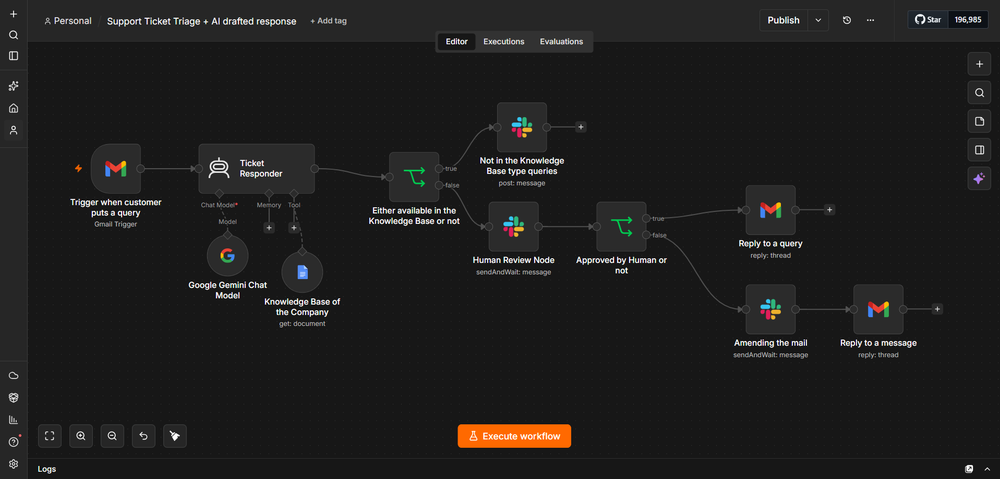

# Support Ticket Triage + AI Drafted Response

Triage customer support emails using a company knowledge base, draft replies with AI, and send them only after human approval on Slack.

## What it does

When a customer emails in, the workflow looks up the company knowledge base (Google Doc), uses a Gemini agent to draft a reply, and routes it through human-in-the-loop review on Slack (sendAndWait, with optional amendment) before sending the reply via Gmail. Queries not in the knowledge base are flagged to Slack.

## How it works

1. Trigger when customer puts a query - Gmail Trigger polls the support inbox.
2. Knowledge Base of the Company - reads the Google Doc knowledge base.
3. Ticket Responder - Gemini agent drafts the reply.
4. Either available in the Knowledge Base or not - IF node.
5. Human Review Node - sends the draft to Slack for review (sendAndWait).
6. Amending the mail - Slack free-text input to amend the reply.
7. Approved by Human or not - IF node gates sending.
8. Reply to a query - sends the approved reply via Gmail (thread reply).
9. Not in the Knowledge Base type queries - posts unanswerable queries to Slack.

## Nodes & services

Gmail Trigger, Google Docs tool, LangChain Agent (Gemini 2.5 Flash), IF, Slack (sendAndWait, freeText), Gmail (reply).

## Files

- Support Ticket Triage + AI drafted response.json - n8n workflow export
- Support Ticket Triage + AI drafted response.PNG - canvas screenshot

## Setup

1. Import the JSON into n8n.
2. Configure Gmail, Google Docs, Gemini, and Slack credentials.
3. Set the knowledge base document URL and Slack channel.
4. Save and activate.

## Credentials required

- Gmail
- Google Docs
- Google Gemini API
- Slack

