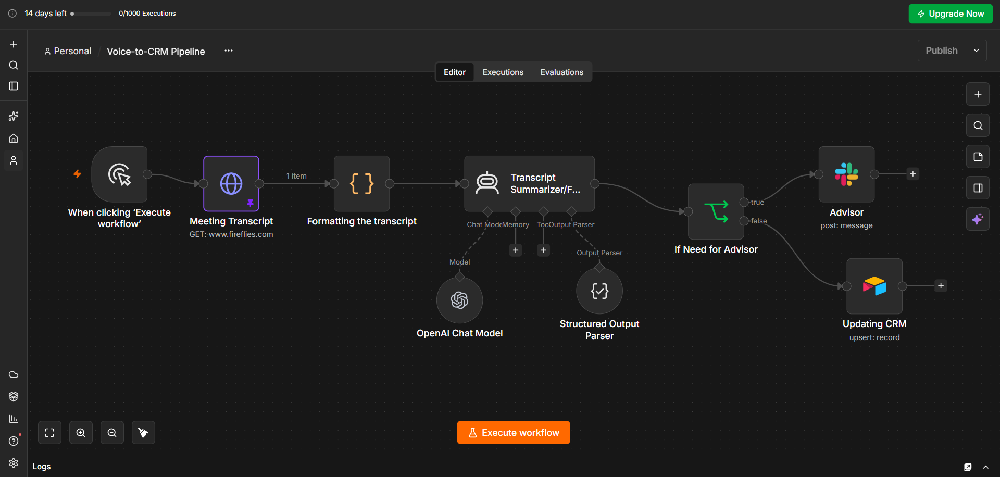

# Voice-to-CRM Pipeline

Transcribes Fireflies meeting recordings, summarizes them into follow-ups with an OpenAI agent, and upserts the result into Airtable CRM.

## What it does

Started manually, the workflow fetches a meeting transcript from Fireflies, formats the transcript, runs an OpenAI agent to produce a follow-up summary and flag, optionally alerts an advisor on Slack, and upserts the record into Airtable.

## How it works

1. Manual Trigger - starts the pipeline.
2. Meeting Transcript - HTTP request to Fireflies for the transcript.
3. Formatting the transcript - Code node maps speakers and text into a readable transcript.
4. Transcript Summarizer / Follow-Up assistant - OpenAI agent returning flag and summary.
5. If Need for Advisor - branches when advisor attention is needed.
6. Advisor - posts the flag and transcript to Slack.
7. Updating CRM - upserts the record into Airtable.

## Nodes & services

Manual Trigger, HTTP Request (Fireflies), Code, LangChain Agent (OpenAI), Structured Output Parser, IF, Slack, Airtable.

## Files

- Voice-to-CRM Pipeline.json - n8n workflow export
- Voice-to-CRM Pipeline.png - canvas screenshot

## Setup

1. Import the JSON into n8n.
2. Configure OpenAI, Slack, and Airtable credentials.
3. Set the Fireflies transcript endpoint and Airtable base/table IDs.
4. Save and activate.

## Credentials required

- OpenAI API
- Slack
- Airtable

